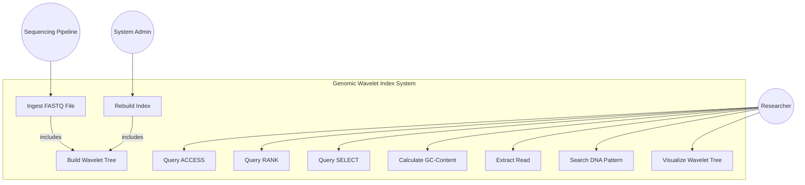
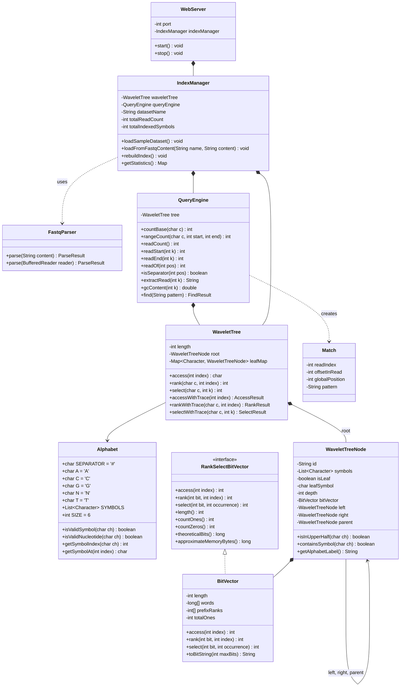

# System Architecture & Design Specification

## 1. Overview & Architectural Philosophy

The **Compressed Genomic Sequence Indexing** platform implements a succinct, query-ready sequence representation centered entirely on a single **Wavelet Tree**.

### Core Design Principles
1. **Single Index Authority**: Only **one** Wavelet Tree is constructed over the entire concatenated sequence $S = \text{read}_0\#\text{read}_1\#\dots\#\text{read}_{r-1}\#$. 
2. **Zero Secondary Persistent Sequence Indices**: No suffix arrays, FM-indices, hash k-mer dictionaries, or duplicate trees exist.
3. **Succinct Bit-Vector Storage**: Internal nodes store packed primitive 64-bit `long` words with constant-time rank lookup structures.
4. **Decoupled Architecture**: Separation of concerns between low-level succinct bit arrays, tree routing, high-level genomic queries, and the presentation layer.

---

## 2. UML Diagrams

### 2.1 Use-Case Diagram



### 2.2 Class Diagram



---

## 3. Component Breakdown & Responsibilities

### 3.1 Succinct Layer
- **`Alphabet.java`**: Enforces strict canonical order $\# < A < C < G < N < T$. Guarantees that tree construction and query routing consistently agree on partition boundaries.
- **`RankSelectBitVector.java`**: Standard interface providing constant-time/sublinear access, rank, and select abstraction.
- **`BitVector.java`**: Concrete implementation packing 64 bits per `long`. Precomputes cumulative word-level counts to achieve $O(1)$ RANK queries via `Long.bitCount`. Implements binary search SELECT in $O(\log n)$ time.

### 3.2 Advanced Data Structure Layer
- **`WaveletTreeNode.java`**: Represents each node in the tree. Internal nodes store a `BitVector` and references to left/right children and parent. Leaves represent terminal symbols.
- **`WaveletTree.java`**: Core data structure. Constructs the balanced binary partition tree recursively. Implements:
  - `ACCESS(i)`: Top-down traversal down to a leaf in 3 steps ($O(\log \sigma)$).
  - `RANK(c, i)`: Top-down branch counting in 3 steps ($O(\log \sigma)$).
  - `SELECT(c, k)`: Bottom-up parent climb in 3 steps ($O(\log \sigma \cdot \log n)$).
  - Discards raw sequence $S$ immediately after construction.

### 3.3 Query & Genomic Analysis Layer
- **`FastqParser.java`**: Enforces standard 4-line FASTQ format, validates DNA characters against $\{A, C, G, N, T\}$, normalizes lowercase letters, and appends `#` delimiters.
- **`QueryEngine.java`**: Implements all 13 required operations exclusively using the WaveletTree.
- **`Match.java`**: Encapsulates verified pattern match coordinates.

### 3.4 Application Facade & Delivery Layer
- **`IndexManager.java`**: Facade managing active index state, telemetry, dataset memory benchmarks, and rebuild operations.
- **`WebServer.java`**: Built-in Java SE HTTP daemon serving REST JSON APIs and hosting the client dashboard.

### 3.5 Authentication & Role-Based Access Control Layer
- **`PasswordHasher.java`**: Cryptographic password hashing using `PBKDF2WithHmacSHA256` with 65,536 iterations, 16-byte secure random salt, and constant-time verification.
- **`User.java`**: Domain model storing user profile, professional category, RBAC roles (`ADMIN`, `REGISTERED_USER`, `GUEST`), and brute-force lockout states.
- **`UserDatabase.java`**: Thread-safe persistent storage using atomic `.tmp` writes and `ATOMIC_MOVE` with pre-seeded demonstration accounts.
- **`SessionManager.java`**: Server-side session store with HttpOnly cookies, CSRF tokens, rate limiting, and per-user `IndexManager` instances providing dataset isolation.

---

## 4. Data Flow Architecture

1. **Ingestion & Validation**:
   ```
   FASTQ Input -> FastqParser.parse() -> Validated Reads List -> String S = read0#read1#...read(r-1)#
   ```
2. **Index Construction**:
   ```
   String S -> WaveletTree.build() -> Root BitVector + Child Subtrees -> Raw String S Discarded
   ```
3. **Query Execution**:
   ```
   User Query -> WebServer REST API -> Resolve User Session -> User's Private IndexManager -> QueryEngine -> WaveletTree (ACCESS/RANK/SELECT) -> JSON Response
   ```

